# 箱庭 DIORAMA · 雨夜便利店 / 樱花车站

> **在线预览**：https://asuka02020.github.io/akari-mart/ （GitHub Pages，桌面 / 手机均可）

纯代码程序化生成的 WebGL 立体箱庭。**没有外部模型、贴图、字体文件或任何框架** ——
便利店、樱花树、列车、电线杆、雨丝、招牌文字、湿地反光，全部由 JavaScript 在运行时生成。

灵感与风格参考自 B 站两个箱庭视频：

- [AI建模界最高的山](https://www.bilibili.com/video/BV1Gchw6uE3Z)（水母菌Jellyfish）
- [DeepSeek V4.1 Flash 一次直出雨夜便利店](https://www.bilibili.com/video/BV16dYJ6GEm1)

本项目是原创的同类型作品（非官方、非复刻），两个场景共享一套渲染器与交互。

## 演示视频

视频作为 Release 附件提供（不占用仓库体积，点击下载）：

- [雨夜便利店 · AKARI NIGHT](https://github.com/asuka02020/akari-mart/releases/download/v1.0.0/akari-night.mp4)（29 秒，1920×1080，24fps）
- [樱花车站 · SAKURA STATION](https://github.com/asuka02020/akari-mart/releases/download/v1.0.0/sakura-station.mp4)（29 秒，1920×1080，24fps）

## 截图

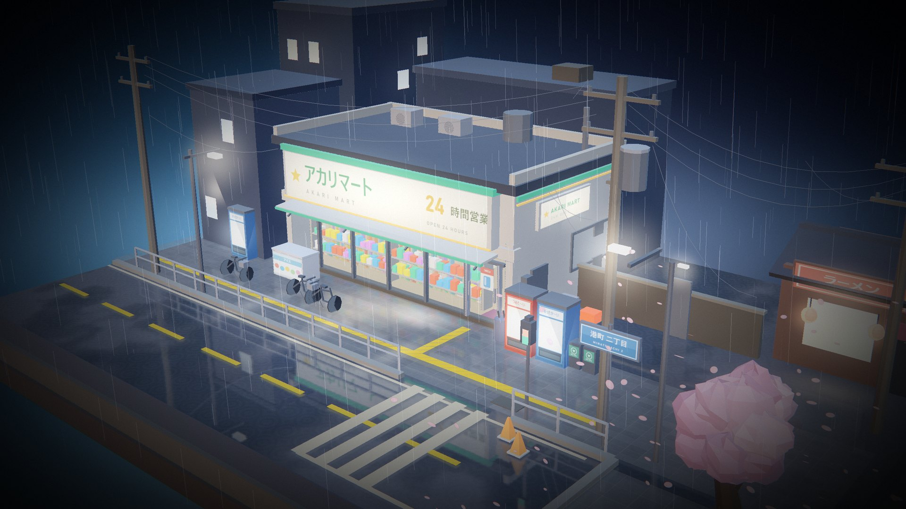

| 店前 | 街道 |
| --- | --- |
| 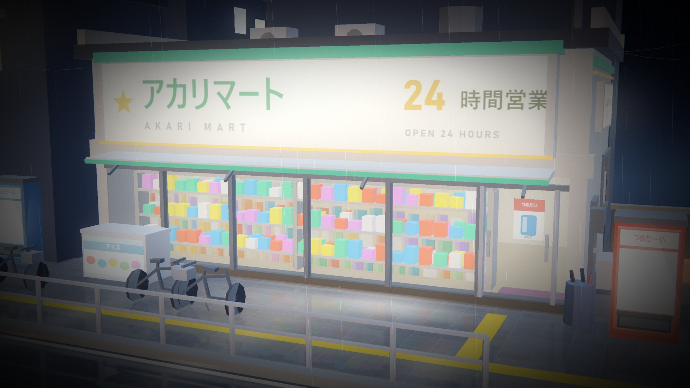 | 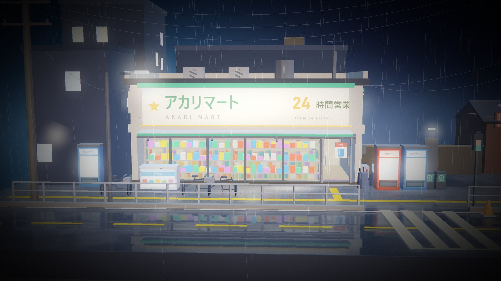 |

| 俯拍 | 樱花车站 |
| --- | --- |
| 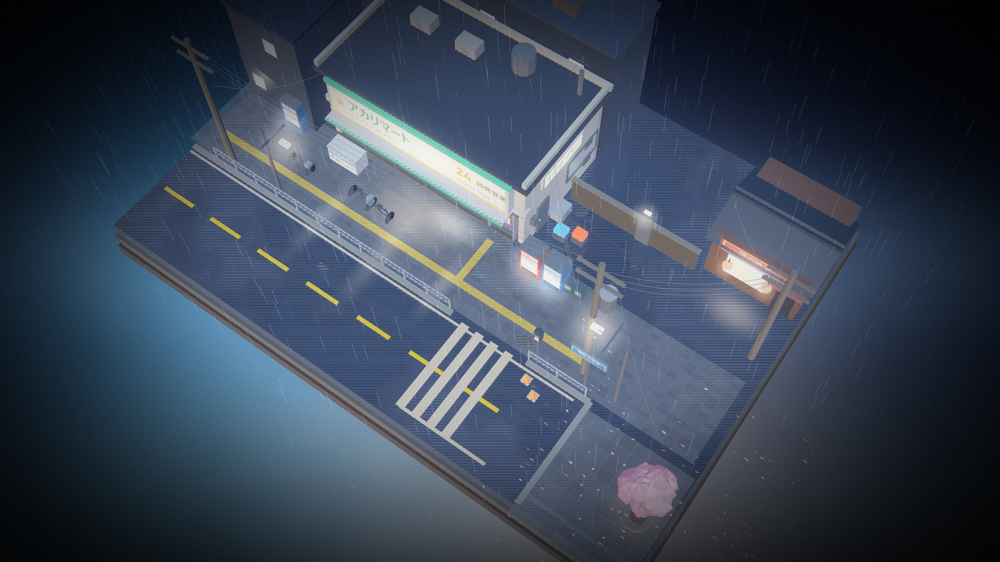 | 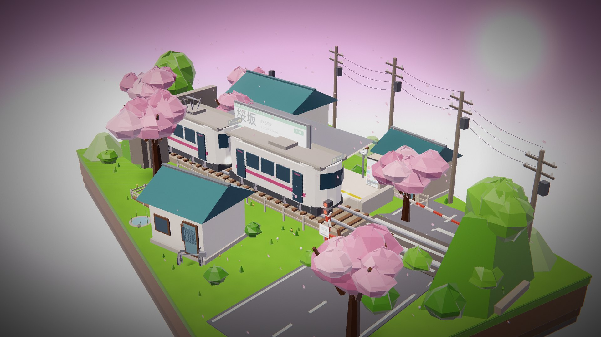 |

| 站台 | 道口 |
| --- | --- |
| 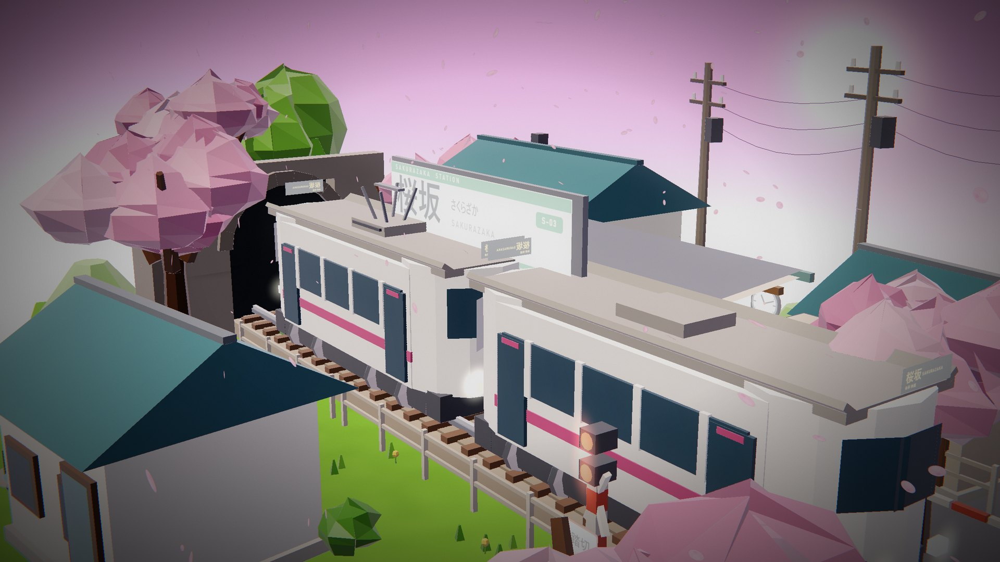 | 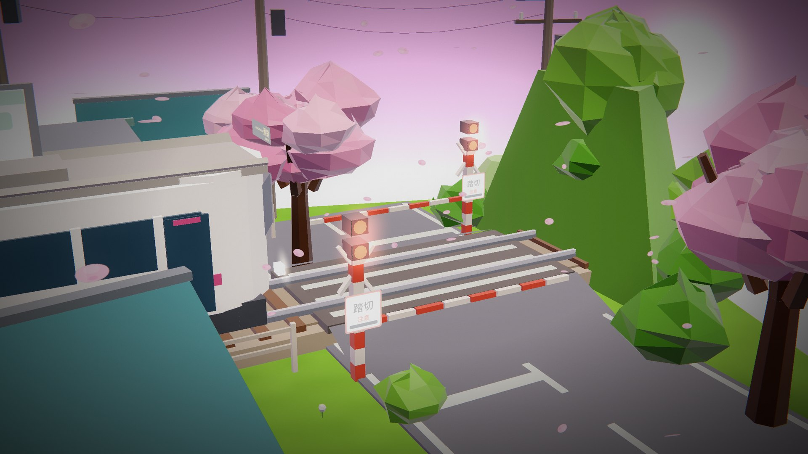 |

| 樱花 | 樱花车站俯拍 |
| --- | --- |
| 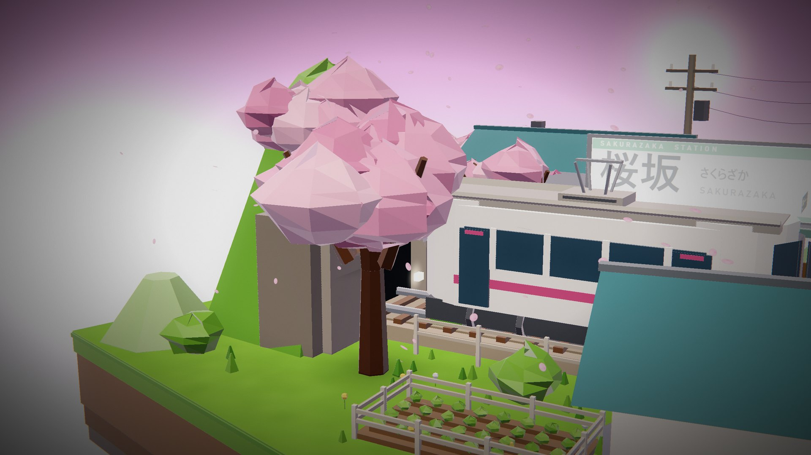 | 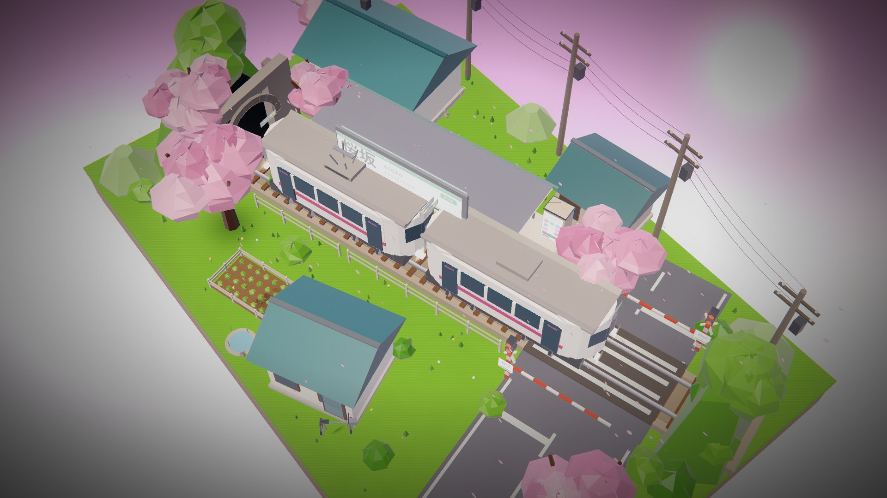 |

**带界面的实际页面**：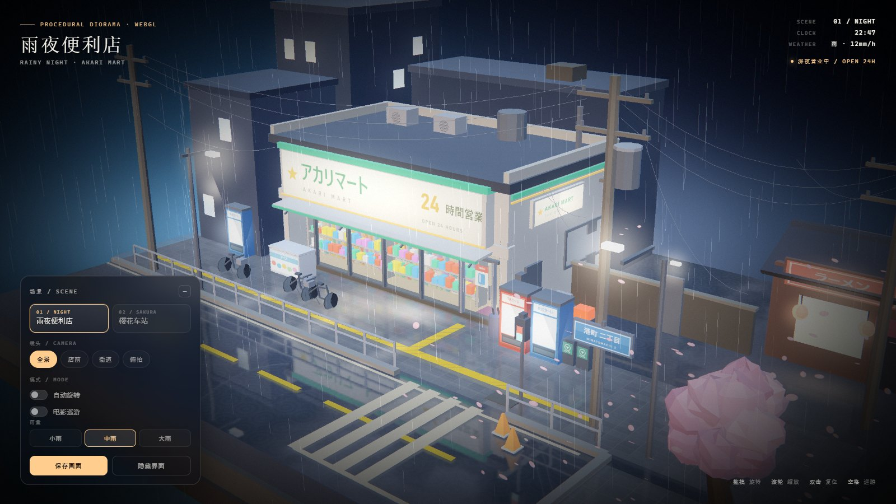 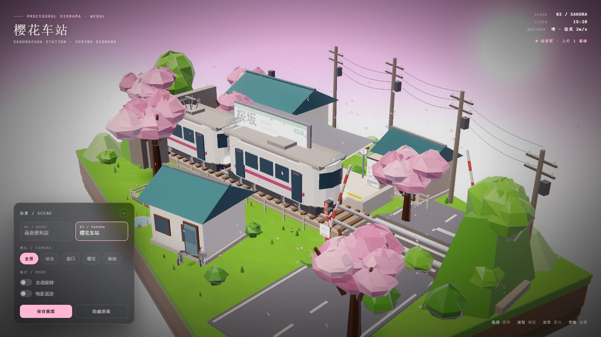

<p align="center">
  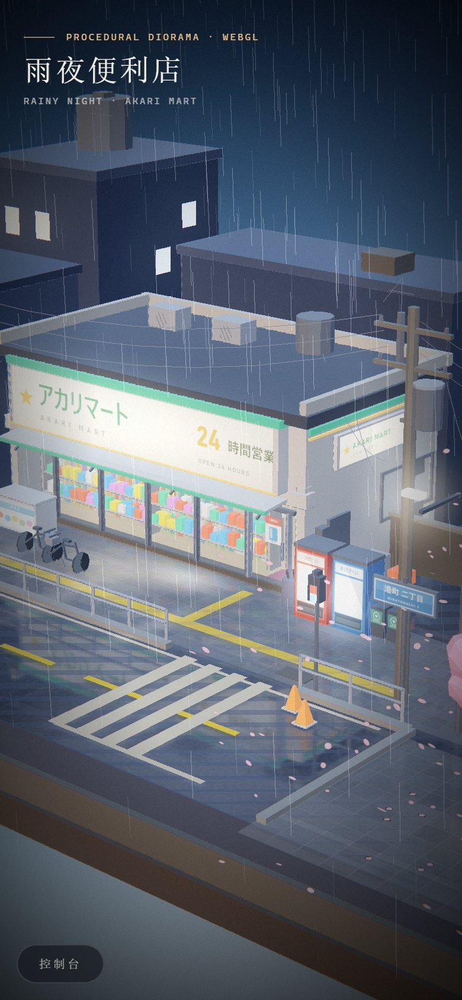
  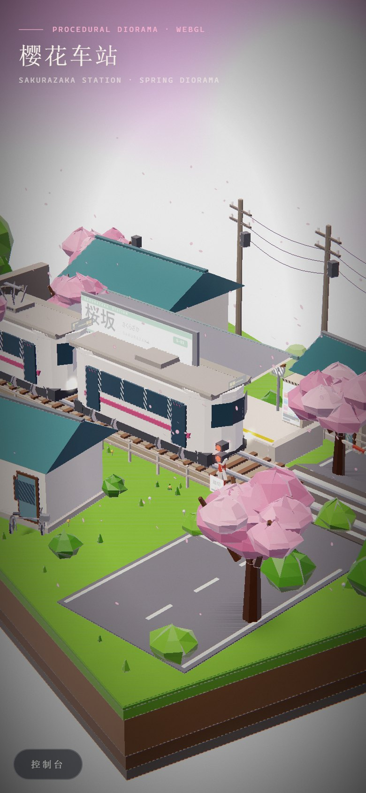
</p>

## 打开方式

**推荐：直接双击 `Diorama.html`。** 这是单文件版本，HTML / CSS / 全部 JS 内联（约 215 KB），
拷到任何地方都能打开，不需要服务器、不需要联网。

也可以打开源码版本 `index.html`（需要保持 `css/`、`js/` 目录结构）。建议使用新版 Chrome / Edge / Firefox，并开启硬件加速。

页面通过 `file://` 直接运行。

## 两个场景

### 01 · 雨夜便利店 / AKARI MART

深夜的街角便利店。霓虹灯箱、室内暖光货架、自动贩卖机、湿漉漉的柏油路，
雨丝与落樱，远处公寓楼零星亮着的窗。所有灯光都会在积水路面上留下倒影。

- 三层切面的立体底座（沥青 / 砂石 / 土层）
- 便利店：玻璃立面、内部货架与彩色商品、收银台、暖色灯带、发光门头灯箱
- 街道：黄色中线、斑马线、路缘石、护栏、路锥、蓝色路牌「港町 二丁目」、行人信号灯
- 城市元素：3 根电线杆与下垂电线、变压器、路灯、公寓楼剪影、拉面店红招牌
- 细节：自动贩卖机 × 3、冰柜、自行车、伞桶、垃圾分类箱、盲道
- 氛围：两层雨粒子、落樱、水坑涟漪、灯箱倒影、呼吸灯与霓虹闪烁

### 02 · 樱花车站 / 桜坂駅

春日下午的乡村小站。粉紫色天空、满开的樱花、单线铁道从隧道口一路穿过站台与道口，
一列两节编组的通勤列车缓缓进站、停靠、再出发。

- 立体草坡底座（草皮 / 泥土 / 岩层切面）
- 铁道：道砟、枕木、钢轨、左侧山体隧道口、右侧平交道口（警示柱、红灯、栏杆、踏切牌）
- 车站：站台、雨棚、站名牌「桜坂 / さくらざか / SAKURAZAKA」、站房、さくら茶屋、长椅、时钟
- 动画：28 秒循环的列车进站—停靠—出站、道口栏杆与红灯联动、飘落花瓣、漂移云
- 周边：瓦顶民居、田垄栅栏、电线杆与电线、山丘、池塘、自行车、小猫

> 非官方同人作品，与上述视频作者及 B 站无关。

## 交互

| 操作 | 效果 |
| --- | --- |
| 拖拽画面 | 环绕旋转镜头 |
| 滚轮 / 双指捏合 | 缩放 |
| 双击画面 | 镜头复位 |
| 「全景 / 店前 / 街道 / 俯拍」 | 场景镜头预设（便利店 4 个、车站 5 个） |
| 场景标签 | 切换雨夜便利店 / 樱花车站 |
| 自动旋转 | 缓慢环绕 |
| 电影巡游 | 自动电影镜头：在两个场景的多个机位间切换、缓慢推移 |
| 雨量 | 便利店专属参数：小雨 / 中雨 / 大雨 |
| 保存画面 | 导出当前帧 PNG |
| 隐藏界面 | 只留画面（截图/录屏用） |
| 快捷键 `1` `2` | 切换场景 |
| `V` / `R` | 下一个机位 / 复位镜头 |
| `空格` | 电影巡游 开/关 |
| `H` / `P` / `A` | 隐藏界面 / 保存画面 / 自动旋转 |

### 可分享的镜头状态（URL hash）

```text
index.html#scene=night&view=1
index.html#scene=sakura&az=1.05&el=0.43&r=35&tx=1.4&ty=2.6&tz=-0.2
index.html#scene=night&ui=0            // 隐藏界面，适合截图
index.html#scene=night&tour=1          // 直接进入电影巡游
index.html#film=1&scene=night          // 确定性定格模式（供视频导出）
```

## 技术实现

- **自研 WebGL1 渲染器**：矩阵数学、GLSL 着色器、VBO/IBO、离屏 FBO、24-bit 深度缓冲、混合通道，无第三方依赖。
- **平面反射**：镜像相机把场景渲染到半分辨率 FBO，湿地面着色器按屏幕空间采样，叠加涟漪扰动、多采样模糊与距离衰减；底座切面、雨、花瓣自动排除。
- **程序化湿地面**：噪声水坑遮罩 + 菲涅尔掠射增强 + 雨滴涟漪 + 积水边缘，反射强度、湿润度按场景配置。
- **辉光后处理**：亮部提取 → 3 次可分离高斯模糊 → 合成，配合暗角、胶片颗粒、轻微色散与整体调色。
- **程序化建模**：所有几何由盒体 / 柱体 / 锥台 / 旋转体 / 抖动球体 / 凸包等基元拼装，按材质合并成批次。
  两个场景合计约 **29.8k 三角形**、约 165 个材质批次，桌面端可轻松 60fps。
- **运行时贴图**：招牌文字、贩卖机面板、花瓣、路牌等由 Canvas 2D 绘制进 2048×1024 图集，再上传为 WebGL 纹理（使用系统中日文字体，无需字体文件）。
- **解析式粒子**：雨丝、花瓣、列车的位置都是时间 `t` 的函数，可任意跳转、暂停，不依赖帧率。
- **确定性电影模式**：`#film=1` 关闭 requestAnimationFrame，由 `app.seek(t)` 逐帧驱动，配合 CDP 截图与 ffmpeg 导出稳定视频（见下）。

## 文件结构

```text
akari-mart/
├─ Diorama.html          # 单文件版本（推荐直接打开）
├─ index.html            # 源码版本入口
├─ css/style.css         # 界面样式
├─ js/core.js            # 数学 / 几何构建器 / 批次合并 / 图集 / 粒子
├─ js/renderer.js        # WebGL 渲染器 / 反射 / 辉光 / 相机 / 巡游 / 定格
├─ js/scene-night.js     # 雨夜便利店场景
├─ js/scene-sakura.js    # 樱花车站场景
├─ js/ui.js              # 界面逻辑
├─ SCENE_API.md          # 场景开发 API 文档
├─ screenshots/          # 成品截图
└─ videos/               # 本地演示视频（未纳入 git，见 Release）
```

开发辅助脚本在工作区根目录 `tools/`（截图、交互测试、单文件打包、视频导出），运行页面本身不需要它们。

## 重新打包单文件

```bash
python tools/build_standalone.py
# 或指定项目
python tools/build_standalone.py --project akari-mart --out Diorama.html
```

## 导出演示视频

```bash
# 雨夜便利店（约 29 秒，1920×1080 / 24fps）
node tools/film.js --scene night --out akari-mart/videos/akari-night.mp4 --w 1280 --h 720 --dpr 1.5 --fps 24

# 樱花车站（约 29 秒，1920×1080 / 24fps）
node tools/film.js --scene sakura --out akari-mart/videos/sakura-station.mp4 --w 1280 --h 720 --dpr 1.5 --fps 24
```

## 兼容性

- 需要支持 WebGL 1 的浏览器；无 WebGL 时页面会给出提示。
- 桌面端建议独显/核显开启硬件加速；移动端会自动拉远镜头并收起控制台。
- 场景数据全部在内存中程序化生成，无网络请求。
